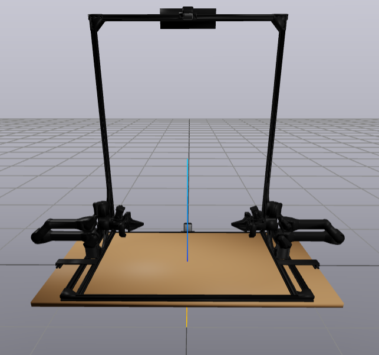
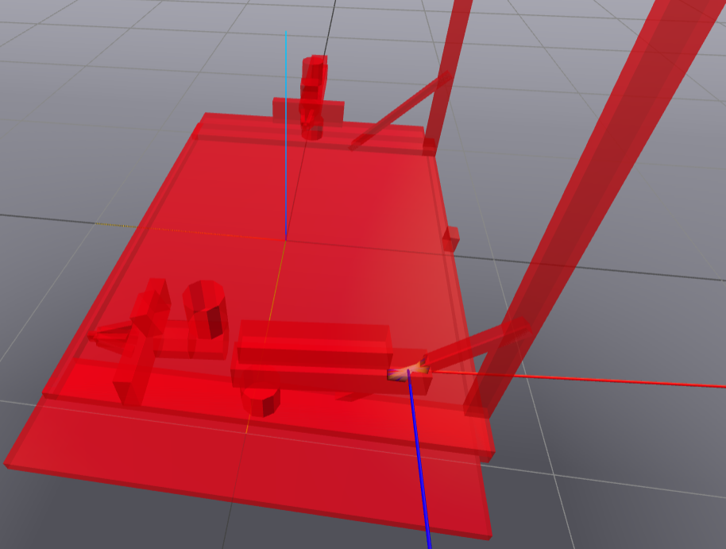

# Trossen Stationary AI

A Drake-compatible model of the bimanual [Trossen Stationary
AI](https://www.trossenrobotics.com/stationary-ai) robot: two 6-DOF
follower arms with parallel grippers, mounted on a tabletop frame with
four cameras — two fixed to the frame (overhead and low-angle) and one
wrist-mounted camera per arm.

Adapted from the [Trossen Arm
Description](https://github.com/TrossenRobotics/trossen_arm_description)
(see [LICENSE.md](LICENSE.md)), via
[trossen_arm_drake](https://github.com/vincekurtz/trossen_arm_drake).

## Actuation

Every joint (6 arm revolute joints + 1 gripper prismatic joints per arm) has a built-in PD controller (`drake:controller_gains` in the URDF). The desired-state input port (`plant.get_desired_state_input_port(...)`) supplies the PD command, while the actuation input port (`plant.get_actuation_input_port(...)`) remains available for optional feed-forward actuation.
**The gains (p=500, d=50) are placeholders carried over from the source description and have not been system-identified against the real hardware** — tracked in issue #12.

## Collision geometry

Collision geometry is intentionally simplified relative to the visual meshes: most links use primitive boxes/cylinders (e.g. each gripper finger is 3 boxes), and some links (e.g. `link_1`) have no collision geometry at all.

